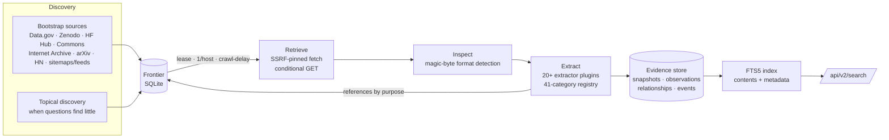

<div align="center">

# Omnispider

**An autonomous crawler that discovers public web resources, retrieves the actual files behind them, and extracts evidence-backed metadata across 41 categories — then answers questions from what it has collected.**

[](https://nodejs.org/)
[](https://www.typescriptlang.org/)
[](#testing)
[](#deploy-on-railway)
[](LICENSE)

</div>

---

## What it does

Nobody types in URLs. A system-managed frontier is seeded from public catalogs, feeds and sitemaps, and grows through everything the crawler reads. Every discovered resource goes through **two connected paths**:

| Path | What happens |
|---|---|
| **Evidence & metadata** | Retrieve → detect the real format from bytes → run the matching extractors (HTML, PDF, Office, images, audio/video, CSV/JSON/XML, feeds, archives, email) → normalise → validate → store each field with its evidence → index |
| **Discovery** | Classify every reference by *purpose* (artifact, licence, methodology, schema, changelog, provenance, citation, model card…) → prioritise → enqueue, with trap, budget and robots controls |

A dataset page is not "done" when its title is indexed: its CSV, methodology PDF, schema, licence page and changelog are retrieved and inspected too, and linked back to it with the purpose they serve.

Users ask ordinary questions; answers come from the **collected corpus** — resources, field-level evidence, supporting documents, and the gaps that remain.

```text
GET /api/v2/search?q=how was the rainfall data sampled

→ methodology.pdf   (supporting:methodology of /datasets/rainfall)
    Statistical · methodologyStatement  "Methodology: sampling design uses 4 tipping-bucket gauges."
                    source claim · resource scope · pdf text layer · 2026-10-29T12:00:00Z
    Statistical · sampleSize            1250
    Identity    · doi                   ["10.5555/rain.2025"]
  referenced by: Regional Rainfall Observations
```

## Architecture



* **Modular monolith** — API, crawler worker and index in one Node process; the corpus is SQLite (WAL) on a Railway volume. One writer, no external queue to operate. Workers are bounded (`CRAWL_CONCURRENCY`, one in-flight request per host).
* **Crash-safe** — work is leased; on restart every outstanding lease is returned to the queue.
* **Stage tracking** — `retrieved_at`, `inspected_at`, `extracted_at`, `indexed_at` are recorded separately per resource; discovery alone never counts as processed.

## Metadata model

Every observation is stored with:

| | |
|---|---|
| value / original | normalised value (UTC ISO dates, checksummed identifiers) and the raw string |
| category | one of 41 ([registry](src/metadata/categories.ts), [coverage matrix](docs/COVERAGE.md)) |
| evidence type | `direct_extraction` (embedded file property) · `source_claim` · `system_measurement` · `inferred` |
| status | `observed` · `source_declared` · `corroborated` · `inferred` · `contradicted` · `extraction_failed` |
| scope | `resource` · `collection` · `organization` · `site` — a footer licence is not stamped onto every file |
| provenance | source resource, snapshot, method/locator, extractor@version, observed-at |

Each resource reports all 41 categories as **observed · not found after inspection · unavailable · not applicable · extraction failed**. Contradictions are preserved, not merged; identical bytes at different URLs are linked as duplicates and not treated as independent evidence; PII is counted and masked, never stored as values.

## Supported formats

| Kind | Extracted |
|---|---|
| Webpages | headers, redirects, meta/OG/Twitter, JSON-LD/microdata/RDFa/Dublin Core, Highwire citations, headings/tables/landmarks, forms → constraints, alt-text/caption audit, licences (with scope), retention statements, SRI, references with page region |
| PDF | Info dict, XMP (incl. PDF/A), page tree, text layer (DOIs, methodology, sample sizes, licence text, links), attachments, signature markers, tagging |
| Office | DOCX/XLSX/PPTX/ODF core + app properties (personal names masked), signatures |
| Images | dimensions, EXIF/IPTC/XMP/ICC, device & firmware, GPS (rounded ~1 km) |
| Audio / video | tags, codecs, sample rate, channels; MP4/MOV box parser: duration, resolution, frame rate, track languages, subtitle tracks |
| Data | CSV dialect/types/statistics/null rates; JSON Schema, OpenAPI, Frictionless Data Package, CKAN, model `config.json`; XML namespaces/XSD, DataCite, sitemaps, RSS/Atom |
| Text | model/dataset cards, `CITATION.cff`, `security.txt`, checksum manifests |
| Archives | ZIP / TAR / TAR.GZ listings, BagIt + checksum manifests, small entries inspected as contained resources (inflation hard-capped) |
| Email | `.eml` headers, reply chains, MIME parts, attachments, DKIM presence (addresses masked) |
| Enrichment | public DNS, TLS certificate, Wayback captures, Crossref corroboration, GitHub / Hugging Face / PyPI / npm registry records, published-checksum verification |

## API

| Method | Path | |
|---|---|---|
| `GET` | `/api/v2/search?q=` | Answer from the collected corpus (evidence, supporting resources, gaps); queues topical discovery when coverage is thin |
| `GET` | `/api/v2/resources/:id` | Full evidence view: stages, 41-category states, observations, relationships, snapshots, crawler events |
| `GET` | `/api/v2/resources?url=` | Look up a collected resource by URL |
| `GET` | `/api/v2/resources/:id/snapshots/:sid` | A historical snapshot with its observations |
| `GET` | `/api/v2/crawler/status` | Frontier, states, kinds, sources, recent events, retention policy |
| `POST` | `/api/v2/crawler/pause` · `/resume` | Admin (requires `API_KEYS`) |
| `GET/POST` | `/api/v2/analyze?url=` | Inspect one public URL on demand (optional) |
| `POST` | `/api/v2/analyze/upload` | Inspect an uploaded file, raw body (optional) |
| `GET` | `/api/v2/categories` · `/extractors` · `/stats` · `/info` | Registry, plugins, latency p50/p95/p99 |
| `GET` | `/health` · `/ready` | Liveness / readiness |

## Run locally

```bash
npm ci
npm run build
DATA_DIR=./data node dist/cli.js serve --port 8080
```

The crawler starts with the server (`CRAWLER_ENABLED=off` to disable). See [`.env.example`](.env.example) for all settings and [`config/discovery.yaml`](config/discovery.yaml) for operator-managed seeds.

## Deploy on Railway

1. Create a service from this repository (Dockerfile build, `railway.toml` included).
2. Attach a **volume mounted at `/data`** — the corpus lives there and survives redeploys.
3. Set `API_KEYS` if you want the admin endpoints; everything else has sensible defaults.
4. Generate a domain. Health check: `/health`.

Keep **one replica**: the corpus is a single-writer SQLite database.

## Safety & compliance

* robots.txt (RFC 9309) per host incl. redirect targets, `Crawl-delay`, `nofollow`; per-host politeness and budgets; failure back-off.
* SSRF protection on every hop: DNS answers are validated and pinned (no rebinding), private/link-local/CGNAT/metadata ranges and IPv4-mapped IPv6 blocked, redirects re-checked, byte caps and decompression-bomb limits everywhere.
* Trap control: pagination limits, calendar and faceted-navigation detection, repeating-path detection, URL canonicalisation (tracking params, fragments, default ports), duplicate content detection.
* Never bypasses logins, paywalls or CAPTCHAs; gated content is recorded as *unavailable*.

## Testing

```bash
npm test                 # 182 tests
npm run coverage:matrix  # regenerates docs/COVERAGE.md from real fixtures
```

The suite includes an end-to-end autonomous crawl against a local multi-resource site (bootstrap source only → index → dataset → CSV/PDF/schema/licence/changelog/archive/media/email/model card → search), version changes with conditional revisits, crawler traps, duplicates, failing parsers and crash recovery; plus real binary fixtures (JPEG+EXIF, PNG, WAV, MP4, PDF, DOCX, zip bomb) and SSRF tests.

## Documentation

* [Repository audit & completion ledger](docs/AUDIT.md)
* [41-category coverage matrix](docs/COVERAGE.md)
* [Security policy](SECURITY.md)

## License

MIT — see [LICENSE](LICENSE).
