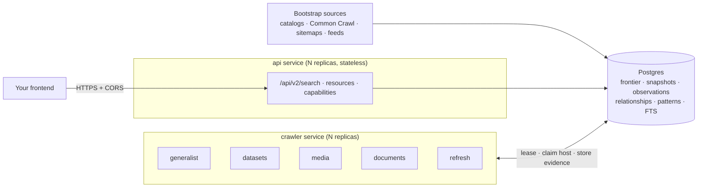

<div align="center">

# Omnispider

**Autonomous crawlers that discover public web resources on their own — pages *and* standalone files — retrieve the actual content, and extract evidence-backed metadata across 41 categories into a searchable corpus.**

[](https://nodejs.org/)
[](https://www.typescriptlang.org/)
[-166534?style=flat-square)](#testing)
[](#deploy-on-railway)
[](#connect-your-frontend)

</div>

---

## The idea in one scenario

Nobody is typing anything. The crawlers discover a public research site through a sitemap. They don't stop at its listing page: they retrieve the **report** (title, author, creation date, producing software, pages, citations, licence), the **photographs** (camera, exposure, capture time, dimensions, credits, GPS rounded to ~1 km), the **video** (duration, resolution, codec, frame rate, subtitle tracks), and the **dataset** (columns, types, units, geographic and temporal coverage computed from the data, missing values, duplicates). Then they follow the **methodology**, **licence** and **revision** records and link them back to the dataset with the right scope.

Later someone asks:

```text
GET /api/v2/search?q=research datasets about snowfall in northern india
```

…and gets the dataset with a fact sheet built from what was already collected: publisher, spatial and temporal coverage, formats, methods (including facts from the linked methodology document), licence and its scope, version, identifiers, supporting sources, and the gaps that remain. Each value carries its evidence.

This exact scenario is an automated test ([`tests/scenario-snowfall.test.ts`](tests/scenario-snowfall.test.ts)), run against both storage backends.

## What makes the crawlers different

| Capability | What it does |
|---|---|
| **Autonomous discovery** | System-managed frontier seeded from public catalogs (Data.gov, Zenodo, Hugging Face Hub, Wikimedia Commons, Internet Archive, arXiv, Hacker News), operator sitemaps/feeds, and the **Common Crawl index by MIME type**. It expands through everything it reads. Users never supply URLs. |
| **Standalone files** | Bare files with no webpage are found via S3/GCS bucket listings, `Index of /` directory pages, Internet Archive manifests, feeds/enclosures, JSON catalogs, references inside PDFs, and archive contents. |
| **Two paths per resource** | *Evidence path:* retrieve → detect format from bytes → extract → normalise → validate → store with evidence → index. *Discovery path:* classify every reference by **purpose** (artifact, licence, methodology, schema, revision, provenance, citation, model card…) → prioritise → enqueue. |
| **Learns its own patterns** | A yield model per URL pattern (`zenodo.org/records/{n}/files/*.csv`) records success rate, fields and categories obtained, and cost. Priorities are re-weighted from it, with an exploration bonus for unseen patterns and a penalty for persistently failing ones. Exposed at `/api/v2/crawler/capabilities`. |
| **Gap pursuit** | When an applicable category is still missing, references matching that category's registry discovery rule are boosted (bounded to 4 per resource; never fabricated). |
| **Specialised crawlers** | Profiles `generalist`, `datasets`, `media`, `documents`, `refresh`. Run them together or as separate services, each with any number of replicas on one shared frontier. |
| **Format-true inspection** | HTML/JSON-LD/microdata/RDFa/Dublin Core/Highwire; PDF (Info, XMP/PDF-A, text layer, attachments, signatures); Office/ODF; EXIF/IPTC/XMP/ICC; **OCR** for text-in-image; audio tags; MP4/MOV box parser; CSV/JSON Schema/OpenAPI/Data Package/CKAN; XML/DataCite/sitemaps/feeds; ZIP/TAR/TGZ (capped, BagIt); `.eml`; model cards; `CITATION.cff`; `security.txt`. |
| **Selective rendering** | Headless Chromium only for pages whose delivered HTML is an empty app shell; never screenshots. |
| **Change awareness** | Conditional revisits (ETag/Last-Modified), adaptive revisit intervals, snapshot history, field-level diffs of meaningful changes. |
| **Safety** | robots.txt (RFC 9309) incl. redirect targets, crawl-delay, one request per host at a time across all replicas, per-host budgets, failure back-off, trap detection (pagination, calendars, facets, repeating paths), SSRF guard with DNS pinning on every hop, decompression caps, no bypassing of logins/paywalls. |

## Evidence model

Every observation is stored with: original + normalised value · category (1–41) · source resource · snapshot · method/locator · extractor@version · observed time · **evidence type** (`direct_extraction` · `source_claim` · `system_measurement` · `inferred`) · **status** (`observed` · `source_declared` · `corroborated` · `inferred` · `contradicted` · `extraction_failed`) · **scope** (`resource` · `collection` · `organization` · `site`).

Every resource reports all 41 categories as **observed · not found after inspection · unavailable · not applicable · extraction failed**. Contradictions are preserved, identical copies are linked as duplicates (not independent evidence), and personal data is counted and masked, never stored. The crawler's own events, state and retention policy are recorded separately from source claims.

The registry ([`src/metadata/categories.ts`](src/metadata/categories.ts)) defines, per category: applicability, methods, core + extended fields, supporting-source discovery rule, validation checks and limitations. See the [coverage matrix](docs/COVERAGE.md).

## Architecture



* **Postgres** is the single source of truth. Crawler replicas coordinate through atomic row claims, so two workers never fetch the same resource, never hit one host concurrently, and run each discovery source once per interval. This is verified by a multi-replica test.
* **API replicas are stateless**, with short answer caching, request coalescing and `Cache-Control` headers so a CDN can absorb repeat traffic.
* SQLite is supported for single-node and local use (`DATABASE_URL` unset).

### Measured performance

`scripts/bench-search.ts` runs a 20,000-document corpus with 64 concurrent connections. It was measured on one 4-vCPU machine that was also running Postgres and the load generator:

| Workload | Throughput | p50 | p99 | Errors |
|---|---|---|---|---|
| Distinct questions (cold) | ~970 req/s | 24 ms | 217 ms | 0 |
| Popular questions (cached) | ~2,400 req/s | 22 ms | 163 ms | 0 |

These numbers came from one machine and are not a promise about yours. Capacity grows by adding API replicas, Postgres read replicas and a CDN. No single deployment serves "everyone on Earth at once", so plan capacity from measurements like these.

## API

| Method | Path | |
|---|---|---|
| `GET` | `/api/v2/search?q=` | Answer from the collected corpus: fact sheets, evidence, supporting resources, gaps |
| `GET` | `/api/v2/resources/:id` | Stages, 41-category states, observations, relationships, snapshots, crawler events |
| `GET` | `/api/v2/resources?url=` | Look up a collected resource |
| `GET` | `/api/v2/resources/:id/snapshots/:sid` | Historical snapshot |
| `GET` | `/api/v2/crawler/status` | Frontier, states, kinds, sources, recent events |
| `GET` | `/api/v2/crawler/capabilities` | Extractor reliability + learned URL-pattern yields |
| `POST` | `/api/v2/crawler/pause` · `resume` | Admin (needs `API_KEYS`) |
| `GET` | `/api/v2/categories` | The 41-category registry |
| `GET` | `/api/v2/openapi.json` | OpenAPI 3.1 spec |
| `GET/POST` | `/api/v2/analyze?url=` · `/api/v2/analyze/upload` | Optional on-demand inspection |
| `GET` | `/health` · `/ready` | Liveness / readiness |

## Connect your frontend

1. Point it at the API service URL (e.g. `https://<api>.up.railway.app`).
2. Set `CORS_ORIGIN` on the API service to your frontend's origin (comma-separated for several; `*` allows any).
3. Generate a typed client from `/api/v2/openapi.json` (e.g. `npx openapi-typescript https://<api>/api/v2/openapi.json -o api.d.ts`).
4. Optional: set `API_KEYS` and send `Authorization: Bearer <key>`.

```ts
const res = await fetch(`${API}/api/v2/search?q=${encodeURIComponent(question)}`);
const { results } = await res.json(); // results[i].facts, .evidence, .gaps, .supportingResources
```

## Deploy on Railway

1. **Postgres:** add the Postgres template.
2. **api service:** deploy from this repo; variables `SERVICE_ROLE=api`, `DATABASE_URL=${{Postgres.DATABASE_URL}}`, `CORS_ORIGIN=…`; generate a domain; scale replicas as needed.
3. **crawler service:** same repo; `SERVICE_ROLE=crawler`, `DATABASE_URL=${{Postgres.DATABASE_URL}}`, `RENDER_JS=on`; no domain; scale replicas or split profiles (`CRAWLER_PROFILES=datasets`) into more services.

Health checks use `/health`. All settings are listed in [`.env.example`](.env.example), and operator-managed seeds are in [`config/discovery.yaml`](config/discovery.yaml).

## Run locally

```bash
npm ci && npm run build
node dist/cli.js serve --port 8080          # SQLite in ./data, API + crawlers in one process
DATABASE_URL=postgres://… node dist/cli.js serve   # Postgres
```

## Testing

```bash
npm test                                         # SQLite
TEST_DATABASE_URL=postgres://… npm test          # SQLite + Postgres (CI does this)
npm run coverage:matrix                          # regenerates docs/COVERAGE.md
DATABASE_URL=postgres://… npx tsx scripts/bench-search.ts 20000 64 20
```

The 210 tests cover:

- the snowfall scenario and an autonomous crawl (index → dataset → CSV/PDF/schema/licence/changelog/archive/media/email/model card → search);
- standalone files via S3/GCS/autoindex/IA listings and Common Crawl;
- a multi-replica frontier (no duplicates, one request per host);
- version changes with conditional revisits, traps, duplicates, failing parsers and crash recovery;
- OCR and selective JS rendering;
- real binary fixtures (JPEG+EXIF, PNG, WAV, MP4, PDF, DOCX, zip bomb), SSRF, CORS, auth and rate limits.

## Documentation

* [Repository audit & completion ledger](docs/AUDIT.md)
* [41-category coverage matrix](docs/COVERAGE.md)
* [Security policy](SECURITY.md)

## License

MIT — see [LICENSE](LICENSE).
